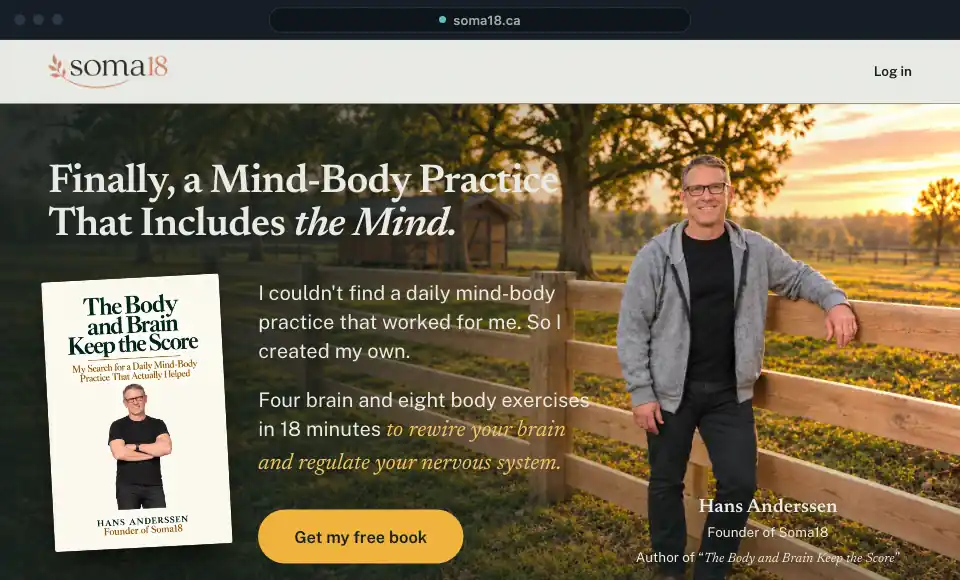

  <picture><source media="(prefers-color-scheme: dark)" srcset="assets/hero-banner-dark.svg"></picture>

  <picture><source media="(prefers-color-scheme: dark)" srcset="assets/rotating-tagline-dark.svg"></picture>

  <a href="https://soma18.ca"><picture><source media="(prefers-color-scheme: dark)" srcset="assets/status-pill-dark.svg"></picture></a>

# Soma18

Soma18 is a daily 18-minute mind-body practice of four brain and eight body exercises, created by its founder, Hans Anderssen. The website offers his free book by email sign-up, a paid video series, and a secure member login for people who have bought it. I built and maintain the website, hosting and online store for Soma18.

**Live site:** [soma18.ca](https://soma18.ca)

<picture><source media="(prefers-color-scheme: dark)" srcset="assets/section-divider-dark.svg"></picture>

## How it fits together

  <picture><source media="(prefers-color-scheme: dark)" srcset="assets/architecture-telemetry-dark.svg"></picture>

A visitor reaches the site on Cloudflare. Clerk handles login, Stripe handles payments, Stream plays the videos and D1 is the database.

## From visitor to viewer

  <picture><source media="(prefers-color-scheme: dark)" srcset="assets/purchase-flow-state-machine-dark.svg"></picture>

Browse the site, sign in, pay once, and the video series unlocks for that account.

<picture><source media="(prefers-color-scheme: dark)" srcset="assets/section-divider-dark.svg"></picture>

## See it

<table>
  <tr>
    <td width="68%" valign="top" align="center">
       
      The public home page, scrolled top to bottom
    </td>
    <td width="32%" valign="top" align="center">
      <picture><source media="(prefers-color-scheme: dark)" srcset="assets/mobile-viewport-frame-dark.svg"></picture> 
      The same page at phone width
    </td>
  </tr>
</table>

<picture><source media="(prefers-color-scheme: dark)" srcset="assets/section-divider-dark.svg"></picture>

## Details

<b>What I built</b>

 

- The public website: one home page that explains the practice, shows the twelve exercises, and introduces Hans.
- The free book: an email sign-up with a consent tick box, followed by an instant download.
- The online store: a one-time purchase of the video series, with payment handled by Stripe.
- A secure member login for people who have bought the series.
- The hosting and the domain setup for soma18.ca.
- Built for older readers: large type, plain wording, and full keyboard support.
- The basics that help people find and trust a site: a clear page title and description, a sitemap, a proper "page not found" page, and self-hosted fonts.

<b>Security approach</b>

 

Kept general on purpose.

- Every member page checks a verified login.
- Videos play through signed links that expire.
- A payment only counts once the payment provider confirms it to the server. The browser is never trusted for this.
- Secrets live outside the code.
- The code repository is private.

<b>What I learned</b>

 

- Check paid access as three different people: logged out, logged in without a purchase, and logged in with one.
- Decide what a refund should do before the first sale, not after it.
- When a release changes the database, the database change goes first.
- Writing for older readers made the whole site clearer: bigger text, fewer words, and error messages that say what to do next.
- Keep notes a non-technical client can read. It saves everyone time.

## Built with

  <picture><source media="(prefers-color-scheme: dark)" srcset="assets/tech-stack-constellation-dark.svg"></picture>

Cloudflare Workers · Hono · TypeScript · D1 · R2 · Stream · Clerk · Stripe

Built with [Claude Code](https://claude.com/claude-code).

<picture><source media="(prefers-color-scheme: dark)" srcset="assets/section-divider-dark.svg"></picture>

## Contact

[LinkedIn](https://www.linkedin.com/in/taha-saiyed/) · [GitHub](https://github.com/TahaSaiyed08)

Code is private to protect the client. Every graphic on this page is a file in this repository: plain SVG and WebP, no scripts and no outside services. See <a href="assets/DESIGN.md">assets/DESIGN.md</a>.
